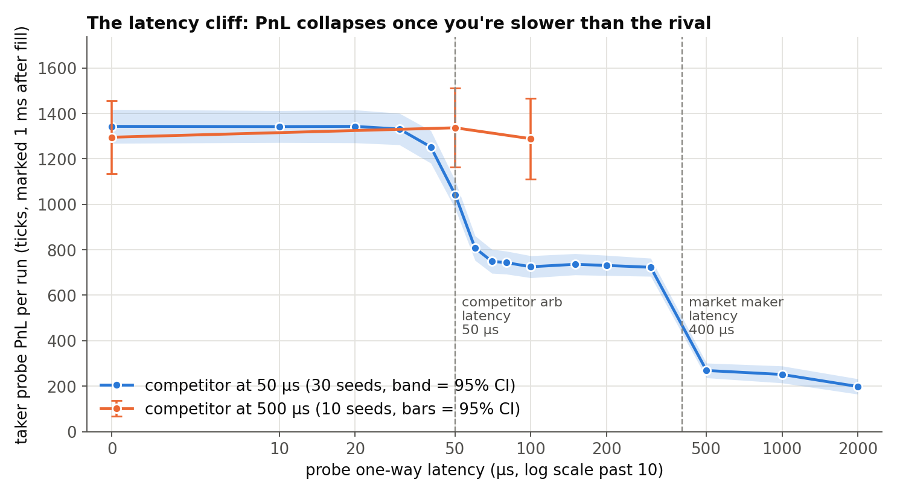
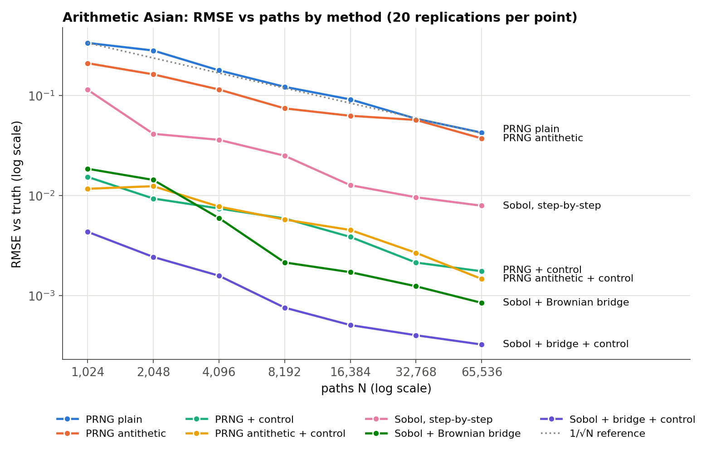
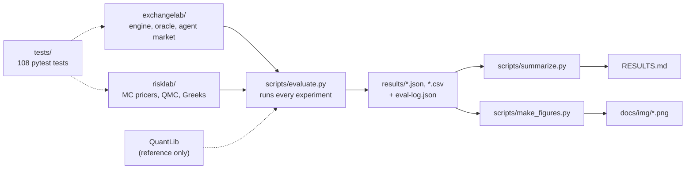

# worldquant-labs: ExchangeLab + RiskLab

**Two small quant labs I built to answer questions I kept wondering about, with every number checked against an independent reference.**

- **[ExchangeLab](exchangelab/)**: *does being 50 microseconds slower actually cost you anything?*
  It's a matching engine (price-time FIFO, IOC, post-only, self-trade prevention) checked against an independent oracle,
  plus a microsecond agent market where a latency-arb probe races a competitor for stale quotes.
- **[RiskLab](risklab/)**: *why do quants obsess over variance reduction? Because a 10x smaller error bar means 100x fewer paths.*
  A Monte Carlo pricing lab: antithetics, control variates, Sobol quasi-Monte Carlo with a Brownian bridge,
  pathwise/likelihood-ratio Greeks, barrier options with a bridge correction and Heston, all checked against QuantLib.

Every number in the docs comes from the JSON in [`results/`](results/), regenerated by the scripts below.

## TL;DR

| | |
| --- | --- |
| Matching engine vs independent oracle | **1.6M commands, 0 mismatches** (incl. IOC / post-only / 2 STP modes) |
| Cost of latency vs a 50 µs competitor | 20 → 70 µs one-way: taker PnL **−44%** (paired, 30 seeds) |
| Same race vs a 500 µs competitor | 0 → 100 µs: no detectable cost (−6.5 ± 55.9 ticks) |
| Sobol + Brownian bridge + control variate | **~17,000x** variance reduction vs plain MC at 65,536 paths (arithmetic Asian, 252 dates) |
| Barrier bridge correction | naive 52-step MC off by **+1.12** (24 SE); corrected −0.02 (0.5 SE) vs QuantLib |

More headline numbers (engine speed, million-path runs) are in the project READMEs and [RESULTS.md](RESULTS.md).

## The two projects

### [ExchangeLab](exchangelab/): the latency cliff



Being slower costs nothing until you're slower than the person you're racing, and then about half the PnL disappears
within ~30 µs. Against a slow (500 µs) competitor, the same extra latency cost nothing I could detect.
→ [ExchangeLab README](exchangelab/README.md) · [interview notes](exchangelab/INTERVIEW_NOTES.md)

### [RiskLab](risklab/): how much each variance-reduction trick buys



Same budget, wildly different error bars: the control variate alone is worth ~740x, and the Brownian bridge is what
makes Sobol points actually help (29x without it, 2,529x with it).
→ [RiskLab README](risklab/README.md) · [interview notes](risklab/INTERVIEW_NOTES.md)

## How the repo fits together



Each lab has its own "How it works" section with a diagram of its key mechanism: the stale-quote race in
[ExchangeLab](exchangelab/README.md#how-it-works) and the Brownian-bridge construction in [RiskLab](risklab/README.md#how-it-works).

## Run it yourself

**Prerequisites:** Python 3.11+. My recorded runs used Python 3.11.18 on an Apple M2 (8 GB). No secrets or API keys
are needed. QuantLib is only a reference/test dependency, never the pricer.

**Setup**

```sh
python3.11 -m venv .venv
source .venv/bin/activate
python -m pip install -r requirements-lock.txt   # see note below
python -m pip install -e '.[test]'
```

`requirements-lock.txt` pins numpy 2.5.4 and scipy 1.18.1, which need Python 3.12. On 3.11 I installed the nearest
compatible versions, **numpy 2.4.6 and scipy 1.17.1**. Every other pin installed as-is (QuantLib 1.44, streamlit 1.66.1).
The recorded results use those 3.11 versions.

**Quickstart (seconds)**

```sh
exchangelab latency-study --seeds 10 --output /tmp/curve.json   # ~15 s, a 10-seed latency curve
risklab qmc --reps 8 --max-log2 14 --output /tmp/q.json         # ~10 s, a small QMC convergence study
```

**Full evaluation (~6–7 minutes; 375 s recorded)**

```sh
python scripts/evaluate.py                         # all experiments, sequential; logs commands + load average
pytest -q --junitxml=results/tests.xml
python scripts/summarize.py                        # rebuilds RESULTS.md and CSVs from results/*.json
python scripts/make_figures.py                     # redraws docs/img/*.png from results/ (needs matplotlib)
```

`evaluate.py --only exchange-benchmark,risk-study` reruns single steps. The laptop is shared with other jobs, so every
timing JSON records the 1/5/15-minute load average, and the exchange benchmark waits (up to 3 min) for the 1-minute load to drop to 2.5 or below.

matplotlib isn't in the pinned requirements, because only the figure script needs it: `python -m pip install matplotlib`.
I drew the committed charts with matplotlib 3.9.2. The script reads only `results/` (plus the generated `RESULTS.md`)
and never reruns an experiment.

**Dashboards**

```sh
streamlit run exchangelab/dashboard.py --server.address 127.0.0.1
streamlit run risklab/dashboard.py --server.address 127.0.0.1 --server.port 8502
```

## Tests

```sh
.venv/bin/pytest -q          # 108 tests, ~10 s
```

| file | tests | covers |
| --- | ---: | --- |
| `tests/test_exchange.py`, `tests/test_exchange_v2.py` | 25 | matching rules, IOC/post-only/STP, lazy cancels and queue position, randomized oracle comparisons, v0 vs fast engine, market determinism, common random numbers, probe causality, inventory skew |
| `tests/test_risk.py`, `tests/test_risk_v2.py` | 24 | closed forms vs QuantLib, estimator units and the control pilot, Brownian bridge, Sobol, RQMC accuracy, Greeks, barrier correction, Heston vs QuantLib |
| `tests/test_interfaces.py` | 3 (parametrized) | CLI smoke tests for both labs, artifact round-trip, dashboard loading |

The 108 count includes the parametrized cases. The last recorded run is in [`results/tests.xml`](results/tests.xml).

## Layout

```
exchangelab/  book.py (fast engine)  book_v0.py (frozen original, benchmark baseline)  reference.py (oracle)
              market.py (agent market)  latency_study.py  experiments.py  events.py  cli.py  dashboard.py
risklab/      paths.py estimators.py analytics.py qmc.py greeks.py barrier.py heston.py validation.py
              studies.py experiments.py cli.py dashboard.py
scripts/      evaluate.py summarize.py make_figures.py
results/      raw JSON + CSV + eval-log.json
docs/img/     charts used in the READMEs (generated by make_figures.py)
tests/        pytest suite
```

## What this isn't

- **Synthetic workloads and toy models only.** Nothing here is live trading, market data, or production code.
- ExchangeLab's agents are simple rules I made up. The *shape* of the latency curve is the finding; the PnL levels depend on my parameters.
- RiskLab's error bars are Monte Carlo error only, not model risk, and the QMC gains are for one smooth ATM Asian payoff.
- Timings come from one shared laptop. Load averages are recorded next to every timing.

Each project README has a longer, specific list.

## Interview notes

- [ExchangeLab interview notes](exchangelab/INTERVIEW_NOTES.md)
- [RiskLab interview notes](risklab/INTERVIEW_NOTES.md)

## References

- ABIDES market simulator (inspiration for the agent market): https://github.com/abides-sim/abides
- QuantLib (independent reference prices): https://www.quantlib.org
- Glasserman, *Monte Carlo Methods in Financial Engineering* (bridge construction, pathwise/LR Greeks, barrier correction)
- Lord, Koekkoek & van Dijk (2010), full-truncation Euler for Heston

None of the upstream projects are affiliated with this repo, and I don't claim contributions to them.

---

Built with AI pair-programming help (Claude / Codex). I've read, run and poked at everything here.
