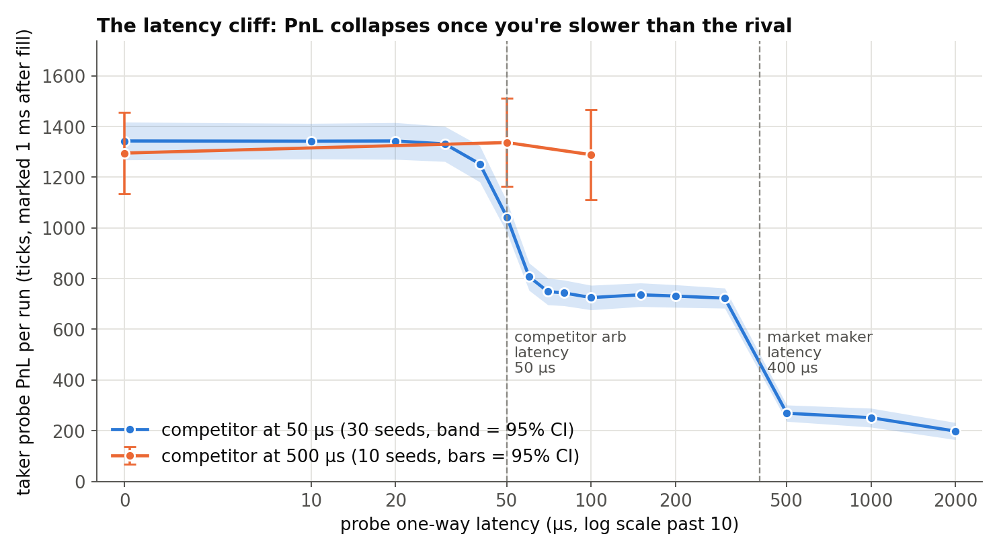
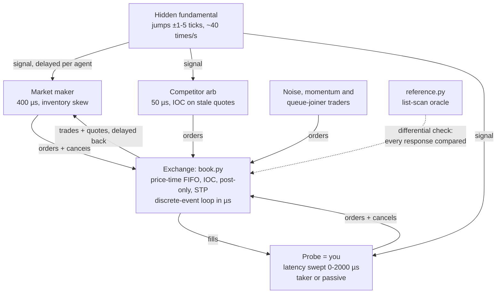
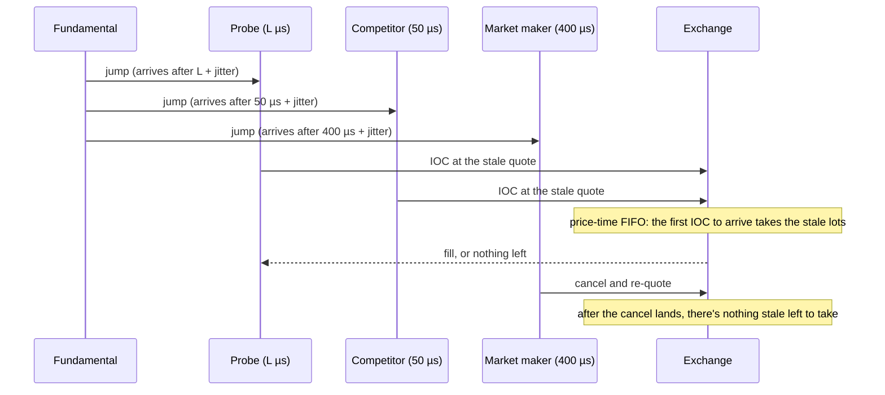
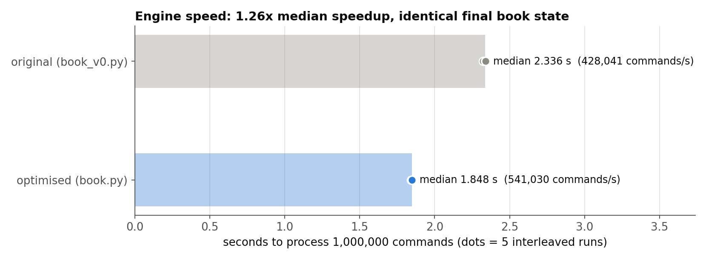
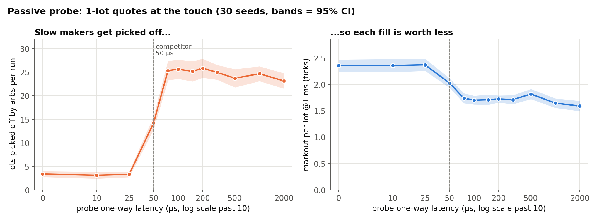

# ExchangeLab

> **Does being 50 microseconds slower actually cost you anything?**

I kept reading that HFT firms pay a fortune for microseconds, and I wanted to see *why* with my own eyes. So I built
a toy exchange, made sure its matching was actually correct, then put robots on it and made one of them slower.

Short answer from my sim: **it depends entirely on who you're racing.**

(Built with AI pair-programming help. All numbers below come from [`../results/`](../results/); see [RESULTS.md](../RESULTS.md).)

## TL;DR

- **Matching engine vs an independent oracle: 1,600,000 commands, 0 mismatches** (including IOC, post-only and two self-trade-prevention modes).
- **Racing a 50 µs competitor:** going from 20 µs to 70 µs one-way cut the latency-arb probe's PnL from **1343.2 ± 72.5 to 749.4 ± 52.7 ticks per run (−44%)**, 30 paired seeds.
- **Racing a 500 µs competitor:** being 100 µs slower cost nothing I could detect (paired change **−6.5 ± 55.9** ticks, 10 seeds).
- **Engine speed:** original **2.336 s** → optimised **1.848 s** median for 1,000,000 commands (**1.26x**). A modest gain, honestly.



## Architecture



Every message leg has the agent's one-way latency plus exponential jitter (mean 10 µs).

## What I built

- **`book.py`** is the fast matching engine. Each price level is a deque with *lazy cancels*: a cancelled order is
  marked dead in O(1) and skipped when it reaches the front. A lazy heap tracks the best price. It supports GTC/IOC,
  post-only, three self-trade-prevention modes (`none`, `cancel_resting`, `cancel_taker`) and `queue_ahead(oid)`.
- **`reference.py`** is a deliberately dumb oracle that re-derives every decision by scanning a flat list.
- **`book_v0.py`** is the original engine, frozen verbatim (including its own `Trade`/`valid()`) so the speed comparison is fair.
- **`market.py`** is the agent world: a hidden fundamental that jumps ±1–5 ticks about 40 times/s; a market maker quoting
  ±2 ticks with inventory skew that keeps queue priority unless its price changes; noise takers; a momentum trader
  reading a delayed tape; slow "queue joiners" who build depth; a competitor arb; and the probe.
- **`latency_study.py`** sweeps probe latency × 30 seeds. Every agent has its own RNG stream, so the same seed gives the
  same fundamental path and order flow at every latency (common random numbers). That lets me report **paired**
  differences, which have much tighter intervals.
- **`cli.py`** and **`dashboard.py`**: a command-line entry point (`exchangelab ...`) and a Streamlit dashboard.

## How it works

The whole latency result comes down to one race. When the fundamental jumps, the market maker's quote is suddenly
stale. Whoever's IOC order reaches the exchange first gets the cheap fill. The market maker is also racing to cancel:



So if L < 50 µs you usually win, if 50 µs < L < 400 µs you get the competitor's leftovers, and past the market maker's
cancel you get almost nothing. Jitter smears each cliff over a few tens of microseconds.

The engine's correctness check is a **differential test**: feed `book.py` and `reference.py` the same random command
stream and compare every response (accept/reject reason, each trade, residual, STP cancels), plus the full resting
book every 1,000 commands.

## Results

### 1. Is the engine right?

| Check | Commands | Mismatches |
| --- | ---: | ---: |
| Original workload (limit/market/cancel), 10 symbols | 1,000,000 | 0 |
| New workload with IOC + post-only, STP off | 200,000 | 0 |
| ... STP `cancel_resting` (13,651 STP cancels) | 200,000 | 0 |
| ... STP `cancel_taker` (13,501 STP cancels) | 200,000 | 0 |

Invariants (FIFO, no crossed book, cash and position conservation) are checked along the way.

### 2. Is it fast?



1,000,000 commands, 5 interleaved runs each after warm-up, load average ~2.2:

| Engine | Median | Range |
| --- | ---: | ---: |
| original (`book_v0.py`) | 2.336 s | 2.322–2.339 s |
| optimised (`book.py`) | **1.848 s** | 1.844–1.850 s |

That's 1.26x. A modest gain, honestly: it's still pure Python, and the timed loop includes per-command bookkeeping
shared by both engines. The wins came from lazy O(1) cancels, caching the best price inside the match loop, and
replacing the frozen-dataclass `Trade` and generator-based `valid()`, which profiling showed were surprisingly hot.
Both engines ended in the identical final book state (same SHA-256) on every run.

### 3. The latency race (taker probe, competitor at 50 µs)

PnL is marked to the hidden fundamental 1 ms after each fill, in ticks (1 tick ≈ 1 bp). Values are 30 seeds, ±95% CI.
The chart at the top shows the whole curve.

| Probe latency | Lots / run | PnL / run | Paired change vs 0 µs |
| ---: | ---: | ---: | ---: |
| 20 µs | 448.6 ± 14.0 | 1343.2 ± 72.5 | +0.1 ± 28.6 |
| 40 µs | 420.1 ± 12.9 | 1252.8 ± 71.4 | −90.3 ± 38.0 |
| 50 µs | 347.8 ± 9.2 | 1042.9 ± 62.0 | −300.2 ± 36.0 |
| 70 µs | 256.9 ± 11.5 | 749.4 ± 52.7 | −593.7 ± 43.8 |
| 500 µs | 90.5 ± 6.8 | 269.0 ± 32.3 | −1074.1 ± 60.5 |

Control: with the competitor at 500 µs, probe PnL at 0/50/100 µs was 1295/1337/1289 ticks, and the paired change at
100 µs was −6.5 ± 55.9. No detectable cost.

### 4. Being slow as a *maker* (passive probe)

The passive probe rests 1-lot quotes at the touch and tries to cancel the stale side when the fundamental jumps.



| Latency | Lots picked off by arbs / run | Markout / lot @1ms | Fraction of rested orders filled |
| ---: | ---: | ---: | ---: |
| 0 µs | 3.4 ± 0.6 | 2.36 ± 0.11 | 0.549 |
| 50 µs | 14.2 ± 1.4 | 2.03 ± 0.09 | 0.581 |
| 75 µs | 25.3 ± 2.1 | 1.74 ± 0.09 | 0.612 |
| 2000 µs | 23.1 ± 1.6 | 1.59 ± 0.10 | 0.644 |

### 5. Inventory skew works

With the probe off, the market maker's mean |inventory| was **60.1 ± 11.0 lots without skew vs 15.2 ± 1.4 with 0.15 ticks/lot skew**.
PnL was also less volatile: 4394 ± 1271 vs 5289 ± 346 ticks.

### What these numbers do NOT show

- **Real-world profits.** The PnL levels depend completely on parameters I picked (jump rate, MM latency, sizes). Only
  the *shape* (a cliff at the competitor's latency) is the robust finding.
- **The 500 µs control is small:** 10 seeds and only three latencies (0/50/100 µs), so its PnL intervals are about twice as wide
  as the main curve's. "No detectable cost" is not "zero cost".
- **Wall-clock speed of a real engine.** ~541k commands/s is pure Python on one shared laptop core; the "µs" in the
  market are simulated clock units, unrelated to how fast the Python runs.

## What surprised me

- **The cost of latency is a cliff, not a slope.** Nothing happens until you cross the competitor's latency, then
  roughly half the PnL vanishes inside ~30 µs. A second cliff comes when the market maker's own cancel beats you.
- **Slow traders win *fewer* races but not *worse* ones.** The taker's markout per lot barely moves (3.05 → 2.91
  ticks from 0 to 100 µs). The money is lost in quantity: you just don't get filled.
- **Slow makers get filled *more*.** That's adverse selection. When you're slow to cancel, the fills you get are the
  ones arbs wanted, so fill rate goes up while markout goes down.
- **The queue-position number was backwards from what I expected.** Average queue-ahead on arrival *falls* with
  latency (5.9 → 4.2 lots). My guess is that slow orders more often land on stale, thinning levels. I haven't fully proven that.
- The `frozen=True` dataclass for `Trade` was one of the most expensive lines in the original engine.

## Run it yourself

Setup (Python 3.11+, `.venv`, pinned requirements) is in the [root README](../README.md#run-it-yourself). Then:

```sh
exchangelab market --latency 45 --mode taker --seed 3 --output /tmp/m.json   # one run, µs latency
exchangelab market --latency 75 --mode passive --output /tmp/p.json
exchangelab latency-study --seeds 10 --output /tmp/curve.json                 # ~15 s
exchangelab validate --count 50000 --mix v2 --stp cancel_resting --output /tmp/v.json
exchangelab benchmark --count 200000 --repetitions 3 --no-quiet-wait --output /tmp/b.json
streamlit run exchangelab/dashboard.py --server.address 127.0.0.1
```

The full recorded study is `python scripts/evaluate.py --only exchange-latency-study` (~36 s), and the whole
ExchangeLab section of the evaluation takes about 3 minutes (most of it the 1.6M-command differential suite).

Things to try: set `competitor_latency_us=10` or `jitter_us=0` in `MarketConfig` (the cliff becomes a perfect step),
`inventory_skew=0`, `mm_latency_us=50` (stale quotes barely exist), or break `book.py` on purpose and watch the oracle catch it. When I tried
three bugs (matching the wrong end of a level, an off-by-one limit check, IOC residuals resting), each was caught within
342 commands of `exchangelab validate`.

Original commands still work: `generate`, `replay`, `validate`, `benchmark`, `compare-latency`, `demo`.

## Tests

From the repo root: `.venv/bin/pytest -q tests/test_exchange.py tests/test_exchange_v2.py` (25 tests, a few seconds).
They cover FIFO and price priority, partial fills, cancel ownership, IOC residuals never resting, post-only, all STP modes,
lazy-cancel queue position vs the oracle, randomized oracle comparisons (v1 and v2 mixes), v0-vs-fast agreement,
market determinism and conservation, common random numbers across latencies, probe causality, "faster beats slower" on
stale-quote races, and inventory skew. `tests/test_interfaces.py` also smoke-tests the CLI commands.

## Layout

```
exchangelab/
  book.py          fast engine              book_v0.py   frozen original (benchmark baseline)
  reference.py     list-scan oracle         orders.py    command / trade types
  market.py        agent market             events.py    discrete-event loop
  latency_study.py latency sweep, CRN, paired CIs
  experiments.py   workloads, differential check, benchmark, original ms-latency demo
  agents.py        the original demo's maker / background / probe agents
  cli.py           `exchangelab` command    dashboard.py            Streamlit dashboard
  INTERVIEW_NOTES.md
```

## What this isn't

- Not a real exchange. One symbol in the agent market, no network stack, no auctions, no hidden or iceberg orders, no fees.
- The agents are simple rules I made up. The *shape* of the latency curve (the cliff at the competitor's latency) is
  the robust finding. The specific PnL numbers depend completely on my parameters (jump rate, MM latency, sizes) and say
  nothing about real profits.
- Markouts use a hidden "true value" that real traders never see.
- "Microseconds" are simulated clock units. Wall-clock speed of the Python engine (~541k commands/s) is a separate,
  much less impressive story than a C++ engine's.
- The oracle comparison shows the fast and slow engines agree on 1.6M random commands. That's strong evidence, not a proof.

## Interview notes

Design decisions, a 2-minute walkthrough and likely follow-ups: [INTERVIEW_NOTES.md](INTERVIEW_NOTES.md).
