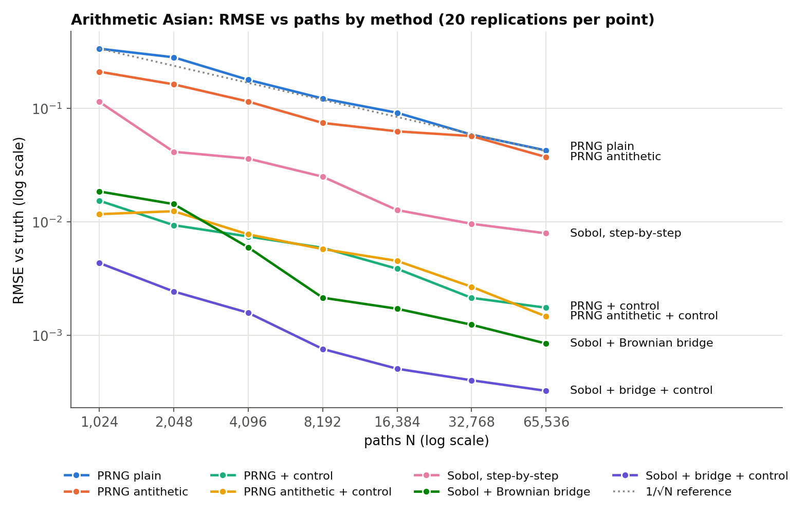
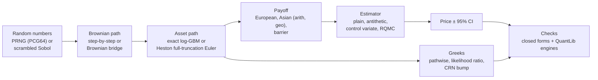
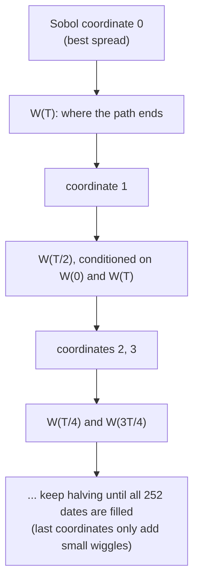
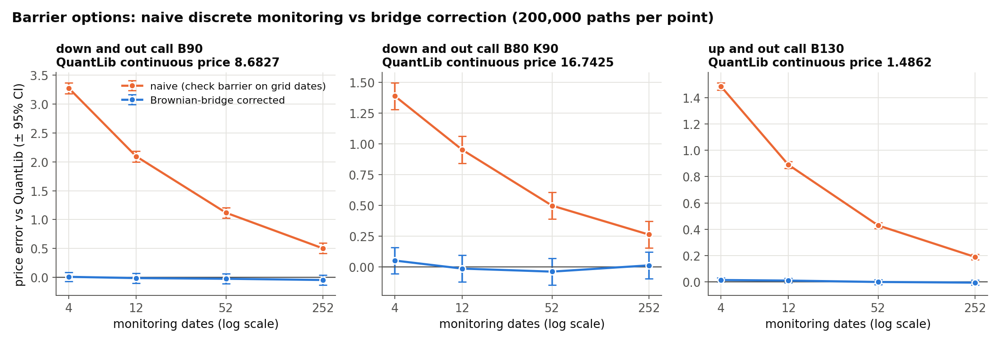
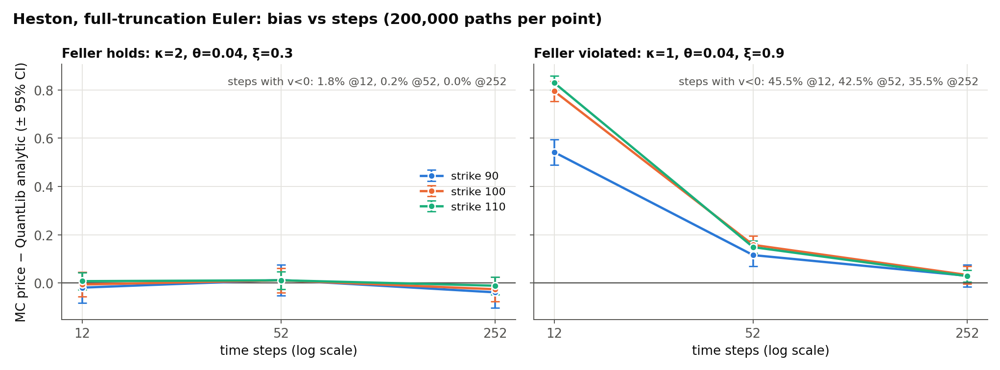

# RiskLab

> **Why do quants obsess over variance reduction? Because a 10x smaller error bar means 100x fewer paths.**

Monte Carlo error shrinks like 1/√N. To halve your error bar you need 4x the paths, and for 10x you need 100x. So
instead of buying more CPU, you get clever about *which* random numbers you draw. I wanted to measure how much each
trick buys, check everything against an independent library (QuantLib), and find where the tricks break.

Every number below is in [`../results/`](../results/); see [RESULTS.md](../RESULTS.md).

## TL;DR

- **Sobol + Brownian bridge + control variate: 17,216x variance reduction** vs plain Monte Carlo at 65,536 paths (arithmetic Asian, 252 fixings). That's RMSE 4.27e-2 → 3.25e-4.
- **The geometric-Asian control variate alone: 736.5x** at an equal 100,000-path budget. Antithetics alone: 2.8x.
- **Barriers:** naive 52-step monitoring is off by **+1.12 (24 SE)**; the Brownian-bridge correction brings it to **−0.024 (0.5 SE)** vs QuantLib.
- **Heston with a violated Feller condition:** 12 steps is off by **+0.79 (37 SE)**, with 45.5% of steps hitting negative variance.



## Architecture



## What I built

- **`paths.py`, `estimators.py`**: streaming GBM in log space, batched so memory stays flat; parallel Welford moments;
  plain, antithetic, control-variate and antithetic + control estimators. The control coefficient is fitted on an
  independent 10,000-path pilot that counts toward the budget.
- **`qmc.py`**: scrambled Sobol with Brownian-bridge path construction, and randomized QMC error bars from independent scramblings.
- **`greeks.py`**: pathwise, likelihood-ratio and bump-and-revalue (common random numbers) delta and vega.
- **`barrier.py`**: knock-out options with a Brownian-bridge crossing correction, plus my own continuous-barrier closed form.
- **`heston.py`**: Heston paths with full-truncation Euler.
- **`analytics.py`, `validation.py`**: closed forms and independent QuantLib references.
- **`studies.py`**: all the v2 experiments; **`cli.py`** (`risklab ...`) and **`dashboard.py`** (Streamlit).

## How it works

The biggest single lever was *how* the Sobol points become a path. Sobol's first coordinates are its best-spread
ones, so the Brownian bridge spends them on the moves that matter most for the payoff:



The step-by-step construction does the opposite. It spends coordinate 0 on the first day's move, so the
worst-spread coordinates end up deciding the shape of the path. Same points, very different results: 29x vs 2,529x.

For barriers, the same bridge idea fixes a different problem. A path observed only at grid dates can cross the
barrier *between* dates without anyone noticing. Given two observed points, the bridge gives the exact probability
that the path crossed in between, so each path is weighted by its survival probability instead of being checked only at the dates.

## Results

All at S0 = 100, K = 100, vol 30%, r = 3%, T = 1 year, 252 equally spaced fixings, unless stated.

### 1. Variance reduction at an equal budget (100,000 paths, arithmetic Asian, 20 seeds)

| Estimator | Variance across seeds | vs plain | Median time |
| --- | ---: | ---: | ---: |
| plain | 1.97e-3 | 1x | 0.203 s |
| antithetic | 7.05e-4 | 2.8x | 0.146 s |
| geometric-Asian control variate | 2.68e-6 | **736.5x** | 0.203 s |
| antithetic + control | 2.39e-6 | 824.1x | 0.149 s |

The control variate works because the geometric-average payoff has a closed form and moves almost one-for-one with
the arithmetic one. A ~737x variance reduction implies a correlation of about 0.9993. Its coefficient is fitted on an *independent* 10,000-path pilot, which is counted in the budget.

### 2. Quasi-Monte Carlo: RMSE vs paths (20 independent replications each)

Arithmetic Asian. The truth is 7.541075 (SE 5.5e-5), from 32 independent Sobol scramblings. QuantLib's own MC gives 7.5405 ± 0.0034.
The chart at the top plots every N; the per-N values are in [`results/risk-qmc-convergence.csv`](../results/risk-qmc-convergence.csv).

| Method | RMSE @1,024 | RMSE @65,536 | Slope | Variance reduction @65,536 | Incl. CPU time |
| --- | ---: | ---: | ---: | ---: | ---: |
| prng plain | 3.37e-1 | 4.27e-2 | −0.52 | 1x | 1x |
| prng antithetic | 2.11e-1 | 3.73e-2 | −0.41 | 1.3x | 1.6x |
| prng control | 1.54e-2 | 1.76e-3 | −0.52 | 590x | 607x |
| prng antithetic + control | 1.17e-2 | 1.47e-3 | −0.51 | 841x | 1,077x |
| sobol, step-by-step | 1.15e-1 | 7.94e-3 | −0.62 | 29x | 16x |
| sobol + Brownian bridge | 1.86e-2 | 8.48e-4 | −0.79 | 2,529x | 1,409x |
| **sobol + bridge + control** | 4.36e-3 | **3.25e-4** | −0.65 | **17,216x** | **8,702x** |

### 3. Greeks: three ways to differentiate a simulation (200,000 paths, ±95%)

| | Delta: pathwise | Delta: LR | Delta: CRN bump | Vega/pt: pathwise | Vega/pt: LR | Vega/pt: CRN bump |
| --- | ---: | ---: | ---: | ---: | ---: | ---: |
| European (QuantLib: 0.5987, 0.3867) | 0.5983 ± 0.0028 | 0.5982 ± 0.0066 | 0.5991 ± 0.0028 | 0.3865 ± 0.0037 | 0.3850 ± 0.0123 | 0.3872 ± 0.0037 |
| Geometric Asian (closed form: 0.5396, 0.1970) | 0.5367 ± 0.0025 | 0.5608 ± 0.0313 | 0.5416 ± 0.0025 | 0.1950 ± 0.0017 | 0.1890 ± 0.0436 | 0.1983 ± 0.0017 |
| Arithmetic Asian (no closed form) | 0.5510 ± 0.0025 | 0.5758 ± 0.0330 | 0.5560 ± 0.0025 | 0.2217 ± 0.0019 | 0.2153 ± 0.0461 | 0.2256 ± 0.0019 |

For a digital call (analytic delta 0.01289), pathwise returns exactly 0, which is wrong. LR gives 0.01290 ± 0.00008,
6x tighter than the CRN bump (0.01269 ± 0.00048).

### 4. Barriers: the bridge correction (200,000 paths, vs QuantLib's continuous-barrier formula)



| Down-and-out call, B = 90 (truth 8.6827) | 4 steps | 12 steps | 52 steps | 252 steps |
| --- | ---: | ---: | ---: | ---: |
| naive (check barrier at grid dates) | +3.27 (67 SE) | +2.10 (44 SE) | +1.12 (24 SE) | +0.50 (11 SE) |
| Brownian-bridge corrected | +0.010 (0.2 SE) | −0.012 (0.3 SE) | −0.024 (0.5 SE) | −0.045 (1.0 SE) |

The same holds for a B=80/K=90 down-and-out and a B=130 up-and-out: every corrected cell is within 1.7 SE. My own closed
form matches QuantLib's `AnalyticBarrierEngine` to 1e-10.

### 5. Heston: when the variance process misbehaves (full-truncation Euler vs QuantLib AnalyticHestonEngine)



| ATM call | 12 steps | 52 steps | 252 steps | Steps with v < 0 (12 / 252) |
| --- | ---: | ---: | ---: | ---: |
| Feller holds (κ=2, θ=0.04, ξ=0.3) | −0.006 (0.2 SE) | +0.011 (0.4 SE) | −0.026 (1.0 SE) | 1.8% / 0.0% |
| Feller violated (κ=1, θ=0.04, ξ=0.9) | **+0.79 (37 SE)** | +0.16 (8 SE) | +0.034 (1.8 SE) | 45.5% / 35.5% |

### 6. Memory: streaming vs holding all paths (fresh process each)

| Paths | Streaming peak RSS | Materialised peak RSS |
| ---: | ---: | ---: |
| 10,000 | 92 MiB | 152 MiB |
| 100,000 | 95 MiB | 591 MiB |
| 1,000,000 | 91 MiB (2.07 s) | not attempted (≈2 GB of shocks on an 8 GB laptop) |

The original million-path stress test still reproduces. Over nine fresh-process runs (strikes 80/100/120 × 3 seeds,
1,000,000 paths + 10,000 pilot), max 95% half-width was **0.00118** and peak RSS **51.4 MiB**, at ~2.04 s each. The
original record was 0.00118 and 54.9 MiB. The scaling table's RSS is higher because that CLI path also imports scipy.qmc and QuantLib.

### What these numbers do NOT show

- **Generality.** The QMC "17,000x" is for one smooth, low-effective-dimension payoff (ATM Asian). QMC gains shrink for discontinuous payoffs and high effective dimension.
- **Precise RMSEs.** Each RMSE uses 20 replications, so it is itself uncertain by roughly ±15%. That's why the curves in the chart wiggle, and why the slopes are rough.
- **Model risk.** Every error bar is *Monte Carlo* error only. None of the models are calibrated to a market.
- **An exact Asian truth.** The arithmetic-Asian "truth" is an RQMC estimate (SE 5.5e-5), cross-checked against QuantLib MC, not a closed form.

## What surprised me

- **The Brownian bridge is the whole QMC story.** Sobol with the obvious step-by-step construction gave only 29x. The
  same points fed through a bridge gave 2,529x. The points didn't change, only which ones drive the big moves.
- **Antithetic sampling is underwhelming here**: 2.8x at a fixed budget, and close to nothing on top of the control
  variate. The control variate alone is ~740x.
- **Likelihood-ratio vega gets worse with more dates.** Its weight sums a term over all 252 steps, so for the Asian it
  was ~24x noisier than pathwise. Yet for a digital, where pathwise is silently *wrong* (0), LR is the best of the three.
- **"More steps" doesn't fix a barrier.** Even at 252 steps (daily monitoring), the naive estimator is off by 11 SE.
  The bridge correction at 4 steps beats the naive estimator at 252.
- **Heston with a violated Feller condition** spends 45% of its steps with negative variance at 12 steps, and the price is off by 37 SE.

## Numerical-stability notes

- Path generation uses exact log-space GBM steps (no Euler error for GBM), and S = exp(log S) never goes negative.
- Moments are aggregated with parallel Welford, avoiding E[X²] − E[X]² cancellation on 1M-path sums.
- Sobol uniforms are clipped to [2⁻⁵³, 1 − 2⁻⁵³] before the inverse normal CDF, so an exact 0 can't become −∞.
- Sobol draws are restricted to powers of two, keeping the (t, m, s)-net balance that QMC's rate depends on.
- The bridge correction uses max(distance, 0), so paths already through the barrier get survival 0 instead of exp(+big).
- Heston uses v⁺ = max(v, 0) in both drift and diffusion (full truncation), with the log-price stepped given v⁺.
- QMC error bars come from *independent scramblings* (RQMC). A single Sobol run has no honest standard error.

## Run it yourself

Setup (Python 3.11+, `.venv`, pinned requirements) is in the [root README](../README.md#run-it-yourself). Then:

```sh
risklab price --kind asian --method antithetic_control --paths 100000 --output /tmp/p.json
risklab qmc --reps 8 --max-log2 14 --output /tmp/q.json              # ~10 s
risklab barrier --barrier 90 --steps 12 --no-correction --output /tmp/b.json   # then drop --no-correction
risklab heston --xi 0.9 --steps 12 --output /tmp/h.json               # violate Feller, compare to QuantLib
risklab greeks-compare --kind asian --fixings 252 --output /tmp/g.json
streamlit run risklab/dashboard.py --server.address 127.0.0.1 --server.port 8502
```

The full recorded study is `python scripts/evaluate.py --only risk-study` (~2 minutes); all the RiskLab steps together take about 3.5 minutes.

Try a deep out-of-the-money strike (`--strike 160`) and watch the CI coverage get shaky. Try removing the bridge
(`bridge=False` in `qmc.prefix_estimates`), or set `beta=0` for the control. You can also replace full truncation with
`np.abs(v)` (reflection) and compare the bias.

Original commands still work: `price`, `greeks`, `sweep`, `validate`, `compare`, `benchmark`, `stress-case`.

## Tests

From the repo root: `.venv/bin/pytest -q tests/test_risk.py tests/test_risk_v2.py` (24 tests, a few seconds).
They cover input validation, closed forms vs QuantLib, zero-vol/zero-maturity edge cases, seed and antithetic units,
the independent control pilot, European parity, the Asian price vs QuantLib MC, the bridge plan and Brownian covariance,
Sobol power-of-two rules, RQMC accuracy on the geometric Asian, pathwise/LR Greeks vs analytic and QuantLib,
LR vega variance growing with steps, the digital-delta failure of pathwise, the barrier closed form and bridge
correction, and Heston vs QuantLib (plus its Black–Scholes limit).

## Layout

```
risklab/
  contracts.py     contract + model specs       analytics.py   closed forms
  paths.py         streaming GBM paths          estimators.py  plain / antithetic / control estimators
  qmc.py           Sobol + Brownian bridge      greeks.py      pathwise / LR / CRN-bump Greeks
  barrier.py       knock-outs + bridge fix      heston.py      full-truncation Euler
  validation.py    QuantLib references          studies.py     all v2 experiments
  experiments.py   original experiments         cli.py, dashboard.py
```

## What this isn't

- Not calibrated to any market. Constant-parameter GBM and one Heston parameter set are toy models, and the error bars
  measure *Monte Carlo* error only, not model risk.
- The QMC "17,000x" is for one smooth, low-effective-dimension payoff (ATM Asian). QMC gains shrink for discontinuous
  payoffs and high effective dimension. The RMSE per N uses 20 replications, so each RMSE is itself uncertain by roughly ±15%.
- The arithmetic-Asian "truth" is itself an RQMC estimate (SE 5.5e-5), cross-checked against QuantLib MC, not a closed form.
- Heston uses plain full-truncation Euler, not the Andersen QE scheme a desk would use. No American or path-dependent Greeks beyond the above.
- Timings are a single shared Apple M2 laptop. Load averages are recorded in the JSON.
